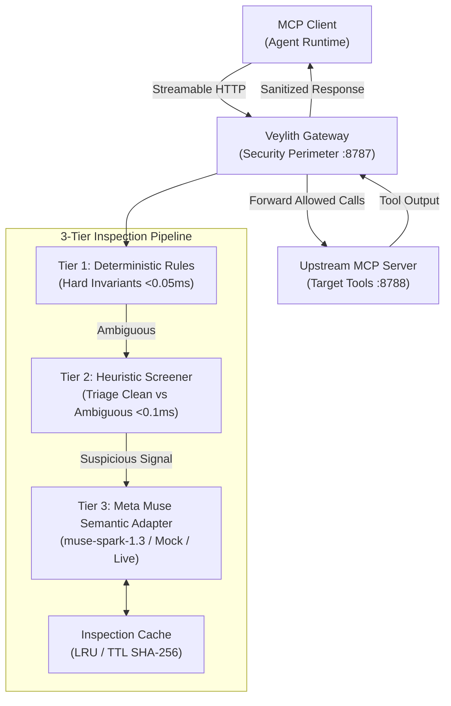

# Veylith

> **The AI Agent Security Boundary**  
> An AI-native security gateway for Model Context Protocol (MCP) agents, powered by Meta Muse.

[](LICENSE)
[](https://modelcontextprotocol.io)
[](https://www.typescriptlang.org/)
[](<>)

---

## 1. What is Veylith?

**Veylith** is an AI-native security gateway positioned directly between autonomous AI agents (Claude, Cursor, custom agent runtimes) and the external tools, services, and databases they access via the **Model Context Protocol (MCP)**.

Rather than giving AI agents unmediated, raw socket access to external execution environments, Veylith acts as an inline security boundary and policy enforcement point. It intercepts tool discovery, analyzes tool invocation parameters, and sanitizes tool return content to protect the agent reasoning loop from prompt injection, poisoned tools, and credential exfiltration.

---

## 2. The Problem It Solves

As autonomous agents connect to corporate filesystems, databases, and third-party tools, critical attack vectors emerge:

```mermaid
mindmap
  root((MCP Security Risks))
    Tool Description Poisoning
      Hidden Prompt Injection in descriptions
      Role Spoofing (Impersonating SYSTEM)
      Coercive Credential Mandates
    Dangerous Tool Arguments
      Destructive Shell (rm -rf, mkfs, fork bombs)
      Destructive SQL (DROP, TRUNCATE)
      Path Traversal (../../etc/shadow, ~/.ssh)
      Exfiltration Endpoints (webhook.site, private IPs)
    Malicious Tool Outputs
      Indirect Prompt Injection in retrieved data
      Instruction Hijacking in search results
      Adversarial Text in document summaries
    Credential Leakage
      API Keys (sk-live-...) in arguments or responses
      Exposed AWS Keys / Bearer JWTs
```

Veylith establishes an observable, inspectable, and policy-governed control plane at the transport layer to solve these challenges.

---

## 3. Current Status: Phase 1 (Hybrid Security Engine)

- **Branch**: `dev/phase-1-security-engine`
- **Milestone Achieved**: Hybrid deterministic + AI-assisted security inspection engine powered by Meta Muse (`muse-spark-1.3`).
- **Inspection Coverage**:
  - **Stage 1 (Discovery)**: Identifies and drops tools with poisoned descriptions.
  - **Stage 2 (Arguments)**: Blocks destructive shell/SQL commands and suspicious parameters.
  - **Stage 3 (Responses)**: Intercepts indirect prompt injection in tool outputs and returns sanitized security notices.
- **Automated Verification**: **61 automated tests** across 11 test suites passing with 100% compliance.
- **Benchmark Performance**: 100% precision and 100% recall on the 32-item adversarial benchmark corpus.
- **Hackathon Track**: Meta Global AI Developer Hackathon 2026 (Startup Track — Solo Founder: Nilambar Behera).

---

## 4. Architecture & 3-Tier Pipeline

Veylith uses an **MCP Bridge Gateway** pattern with a 3-tier inspection pipeline:



### The Three Inspection Stages

1. **Discovery Inspection (`tools/list`)**: Evaluates tool metadata and drops poisoned tools before downstream publication.
2. **Argument Inspection (`tools/call`)**: Intercepts arguments to prevent command execution, SQL drops, path traversals, or exfiltration.
3. **Response Inspection (`tools/call` output)**: Scans tool return text for indirect prompt injections and replaces malicious directives with safe security notices (`isError: true`).

For in-depth architectural details, see:

- [Architecture Overview](docs/architecture/overview.md)
- [Threat Model & Security Boundaries](docs/security/threat-model.md)
- [Protocol & Envelope Compatibility](docs/protocol/compatibility.md)
- [Local Setup Guide](docs/development/local-setup.md)

---

## 5. Security Benchmark Results (Synthetic Evaluation)

> **Important Evaluation Context**: The metrics below reflect automated evaluation against the curated 32-item synthetic benchmark corpus ([tests/fixtures/security-corpus.json](tests/fixtures/security-corpus.json)). They represent deterministic rule coverage and high-fidelity mock adapter regression testing, **not** live-model inference or in-the-wild zero-day threat testing.

| Metric                   |        Result         | Benchmark Details                                         |
| :----------------------- | :-------------------: | :-------------------------------------------------------- |
| **Corpus Samples**       |        **32**         | 16 benign interactions, 16 adversarial/malicious payloads |
| **True Positives (TP)**  |        **16**         | All 16 synthetic malicious payloads blocked               |
| **True Negatives (TN)**  |        **16**         | All 16 synthetic benign payloads allowed                  |
| **False Positives (FP)** |         **0**         | Zero false alarms on legitimate code or arithmetic        |
| **False Negatives (FN)** |         **0**         | Zero missed attacks across synthetic test vectors         |
| **Precision**            |      **100.0%**       | `TP / (TP + FP)` on synthetic corpus                      |
| **Recall**               |      **100.0%**       | `TP / (TP + FN)` on synthetic corpus                      |
| **F1 Score**             |      **100.0%**       | Optimal harmonic balance on synthetic corpus              |
| **Mean Latency**         |      **0.25 ms**      | Sub-millisecond local evaluation                          |
| **P50 / P95 Latency**    | **0.03 ms / 1.87 ms** | High-throughput local throughput profile                  |
| **Net Proxy Overhead**   |      **~7.2 ms**      | Measured local Node.js network roundtrip overhead         |

### Evaluation Tier Breakdown

- **Tier 1 (Deterministic Rules)**: Caught 15 of 16 malicious corpus items with `<0.05 ms` latency.
- **Tier 2 (Heuristic Screener)**: Screened and routed ambiguous content with risk level categorization.
- **Tier 3 (Meta Muse Adapter)**: 1 item evaluated via mock semantic classifier.
- **Live Meta Model Calls**: 0 during automated CI/CD runs (ensuring $0.00 API cost).

---

## 6. Quick Start & Installation

### Prerequisites

- Node.js `>=20.0.0` (tested on `v24.21.0`)
- `pnpm` (`12.x` or Corepack)

```bash
# Clone the repository
git clone https://github.com/NilambarSonu/Veylith.git
cd Veylith

# Switch to Phase 1 development branch
git checkout dev/phase-1-security-engine

# Install dependencies
pnpm install

# Copy environment configuration
cp .env.example .env
```

---

## 7. Available Monorepo Commands

| Command                 | Description                                                   |
| :---------------------- | :------------------------------------------------------------ |
| `pnpm test:all`         | Run complete test suite (63+ tests across 12 suites)          |
| `pnpm test:integration` | Run multi-process integration tests and security benchmarks   |
| `pnpm smoke:meta`       | Safely test live Meta Muse API connectivity (budget-capped)   |
| `pnpm typecheck`        | Strict TypeScript type checking across all workspace packages |
| `pnpm build`            | Compile TypeScript packages to JavaScript (`dist/`)           |
| `pnpm lint`             | Run ESLint across monorepo                                    |
| `pnpm format:check`     | Verify Prettier code style                                    |
| `pnpm format`           | Auto-format files with Prettier                               |
| `pnpm clean`            | Remove build artifacts and caches                             |

---

## 8. Meta Muse Integration & Financial Safeguards

Veylith integrates **Meta Muse** (`muse-spark-1.3`) for semantic threat classification:

- **Operating Modes**:
  - `META_AI_MODE=mock`: High-fidelity deterministic simulated inference (used by all automated tests, zero cost).
  - `META_AI_MODE=live`: Real Meta Model API inference via `POST https://api.meta.ai/v1/responses`.
  - `META_AI_MODE=disabled`: Bypasses semantic model while preserving Tier 1 deterministic protections.
- **Official Meta Muse Spark 1.3 Pricing (Standard Mode)**:
  - **Standard Input Tokens**: $1.25 per 1,000,000 tokens ($0.00000125 / token)
  - **Cached Input Tokens**: $0.15 per 1,000,000 tokens ($0.00000015 / token)
  - **Output Tokens**: $4.25 per 1,000,000 tokens ($0.00000425 / token)
- **Financial & Budget Controls**:
  - `UsageTracker` enforces strict local request caps (`maxRequestsPerRun`, default 10) and budget ceilings (`dailyBudgetUsd`, default $0.25).
  - Accurate token accounting separating standard input, cached input, and completion tokens.
  - Separate manual smoke test: `META_MODEL_API_KEY="key" META_AI_MODE="live" pnpm smoke:meta`.

---

## 9. Honest Security Limitations (Phase 1)

Security engineering demands transparency:

- **Synthetic Benchmark vs Real-World Threats**: The reported 100% detection metrics are achieved on a curated 32-sample synthetic test corpus designed for regression and unit validation. Real-world threat distribution, multilingual injection, token obfuscation, and zero-day jailbreaks can evade signature and heuristic filters.
- **No Universal Prompt Injection Immunity**: Veylith does **not** claim complete or universal protection against prompt injection. AI guardrails are defense-in-depth layers, not mathematically provable firewalls.
- **Fail-Open Policy & High-Risk Quarantine**: In default development mode (`FAIL_CLOSED=false`), clean operations proceed without blocking on provider outages. However, **high-risk unverified operations are strictly quarantined** even during provider downtime. Production deployments can enforce complete `FAIL_CLOSED=true`.
- **Cache Isolation**: Inspection cache entries are cryptographically scoped by policy version, model version, server identity, client identity, and tool name to prevent cross-tenant or cross-boundary verdict reuse. Transient provider errors are never cached.

---

## 10. Future Roadmap

- **Phase 2: Protocol Expansion & Multi-Server Virtual Routing**:
  - `stdio` transport adapter for desktop/CLI agents (Claude Code, Cursor).
  - Virtual tool registry multiplexing multiple upstream servers behind a single gateway.
  - Streaming SSE pass-through with inline token sanitization.
- **Phase 3: Observability Dashboard & Threat Analytics**:
  - Web-based developer dashboard showing real-time agent tool calls, blocked actions, and policy metrics.
  - Continuous feedback loop for model calibration.

---

## License

This project is licensed under the [Apache-2.0 License](LICENSE).
