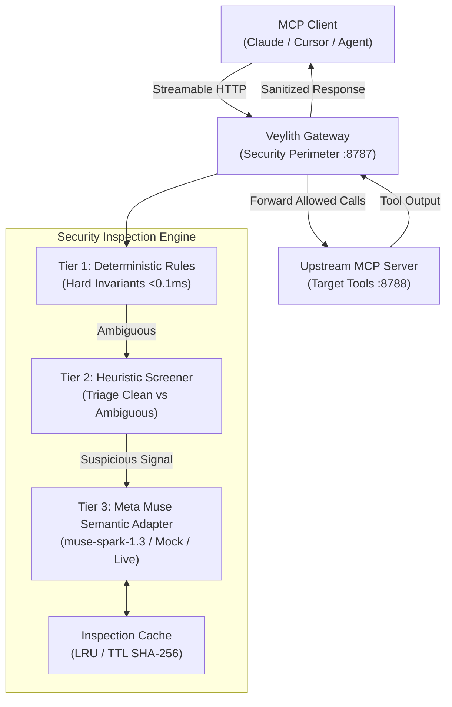
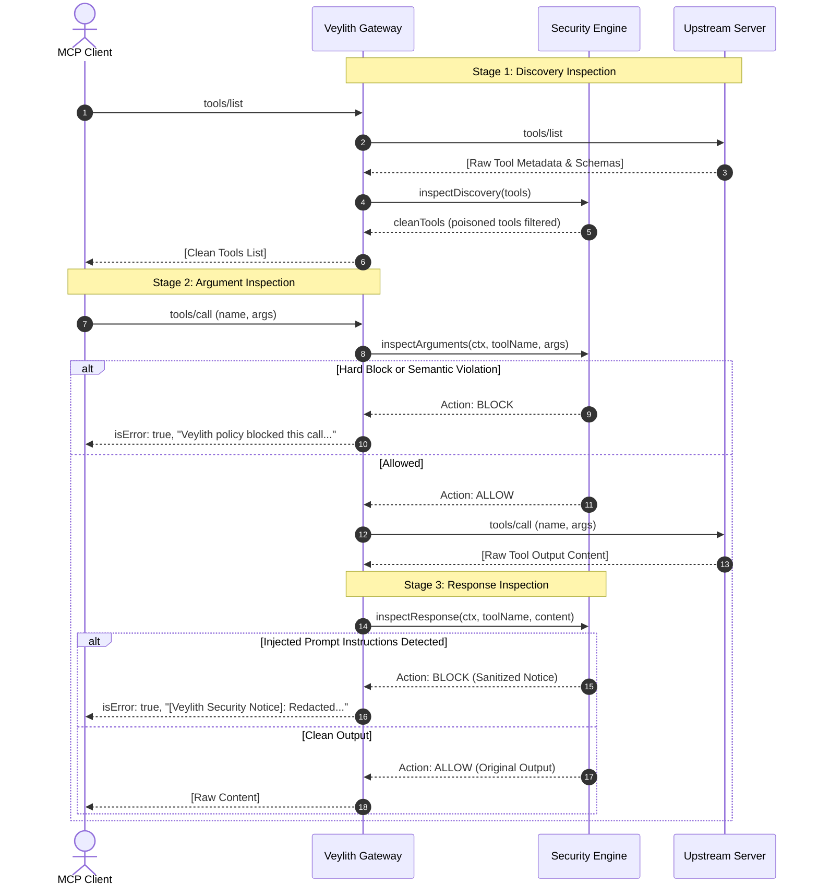

# Veylith Architecture Overview

## Introduction

**Veylith** is an AI-native security gateway positioned between Model Context Protocol (MCP) clients (autonomous agents, LLM runtimes, agent orchestrators) and upstream MCP servers (tools, resources, prompt providers).

During **Phase 1**, Veylith evolves from a transport bridge into a **hybrid deterministic + AI-assisted security inspection engine**, powered by Meta Muse (`muse-spark-1.3`).

---

## Architectural Topology

---

## The Three Inspection Stages

Veylith provides complete defense-in-depth across three distinct operational stages of the MCP protocol lifecycle:

---

## Tiered Performance Strategy

To balance low latency with deep semantic analysis, Veylith uses a 3-tier processing pipeline:

| Tier       | Component                    | Latency                                   | Scope & Role                                                                                                                                                                                                                                       |
| :--------- | :--------------------------- | :---------------------------------------- | :------------------------------------------------------------------------------------------------------------------------------------------------------------------------------------------------------------------------------------------------- |
| **Tier 1** | **Deterministic Rules**      | `<0.05 ms`                                | Evaluates hard security invariants (destructive shell commands like `rm -rf`, destructive SQL `DROP TABLE`, path traversal `../../etc/shadow`, known credential regexes, explicit tool deny-lists). **Hard blocks can never be overridden by AI.** |
| **Tier 2** | **Heuristic Screener**       | `<0.1 ms`                                 | Triages payloads into `clean` (fast-path allow, skipping LLM), `hard_violation` (fast-path block), or `ambiguous` (contains suspicious keywords or patterns).                                                                                      |
| **Tier 3** | **Meta Muse Semantic Model** | `~10–15 ms` (mock) / `~300–600 ms` (live) | Evaluates ambiguous cases using Meta Muse (`muse-spark-1.3`). Features XML delimiter trust separation and strict Zod output validation.                                                                                                            |

---

## Core Components

### 1. `apps/gateway` (MCP Bridge Gateway)

- Implements Streamable HTTP MCP server interface for downstream clients.
- Connects as an MCP client to upstream servers using `@modelcontextprotocol/client`.
- Integrates `SecurityInspectionEngine` across discovery, call arguments, and tool outputs.
- Redacts sensitive credentials in audit logs.

### 2. `packages/core` (Domain Foundation)

- Protocol-agnostic domain layer.
- `InspectionStage`: `'discovery' | 'call_arguments' | 'call_response'`.
- `ThreatCategory`: `'tool_poisoning' | 'suspicious_arguments' | 'malicious_response' | 'credential_leak' | 'destructive_command' | 'none'`.
- `PolicyAction`: `'allow' | 'block' | 'review'`.
- `SecurityInspectionResult`: Structured audit verdict with rule ID, model ID, origin, confidence, and sanitized evidence.

### 3. `packages/policy-engine` (Hybrid Engine)

- `DeterministicRuleSet`: In-memory pattern scanner covering destructive execution, exfiltration URLs, and directive overrides.
- `HeuristicRiskScreener`: Fast regex/keyword screener triaging requests.
- `InspectionCache`: Bounded in-memory LRU/TTL cache keyed by `SHA-256(payload) + stage + policyVersion + modelVersion`.
- `SecurityInspectionEngine`: Master coordinator orchestrating all three tiers.

### 4. `packages/meta-adapter` (Meta Muse Integration)

- `MetaMuseSecurityAdapter`: Handles `mock` (offline deterministic simulation), `live` (Meta Model API `POST /responses` to `https://api.meta.ai/v1`), and `disabled` modes.
- `UsageTracker`: Application-level budget cap enforcing maximum requests per run and daily USD budget caps with token accounting.
- **Trust Separation**: Untrusted input is strictly encapsulated within `<untrusted_content>` tags, instructing the model to treat the content purely as passive data.

---

## Trade-offs and Invariants

1. **Deterministic Precedence**: AI inference is strictly consultative; it cannot unblock a payload flagged by a Tier 1 deterministic invariant.
2. **Fail-Closed vs Fail-Open**: In development mode, ambiguous unblocked interactions default to `allow` (fail-open) for developer velocity. In production profiles, `failClosed: true` flags any model outage or `review` verdict as a block.
3. **Local Privacy**: Model inspection is strictly performed from the backend gateway; API keys are never delivered to clients or browser runtimes.
